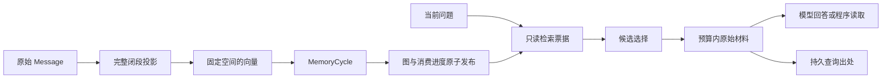

# Akasha 2：带原始证据的情景记忆

记忆的目标是让后续工作用上曾经确认的内容，并能查清依据。检索命中、材料呈现、模型回答和最终投递是四个不同事实，需要分别验证。

## 值得打磨的使用场景

**记得线索之后，还能回到当时的原话继续查证。** 对长报告、研究记录和多轮讨论，第一次召回的片段未必包含所需细节。Akasha 保留消息身份与原文范围，让 Agent 在需要时继续读取同一个来源，而不是只能相信摘要或重新猜答案。这条能力适合“上次那份材料里究竟怎么确认的”这类问题。

**历史不只用于回答，也能成为后续行动的条件。** 预算、时间安排和使用限制来自过去的对话，新事件只提供新事实。调查把两者合起来决定分享或跳过，结果能追溯到实际读过的用户记录。已有六组邮件条件对照中，12 次调查都呈现了对应历史，11 次行动符合预期；误读的一次保留，并单独验证用户澄清后的复查。

**长期使用后，仍能复核当时读过什么。** 查询出处与学习图分开持久化；读取、重试、组件重载与学习恢复分别核对。这里要证明的是经历可追溯、工作可接续，而不是用恢复测试的通过率代替回答质量。

这三个场景分别用最终回答、实际行动和来源一致性验证。关联图、融合排序与材料策略是实现手段；某种手段是否值得保留，由它在对应场景中的实际贡献决定。最新[场景实测](../operations/evaluations/2026-10-22-memory-scenarios.md)固定相同初始材料，末页和中部取证的有原文支持正确答案从 0/8 增至 5/8，并分别记录追加成本。其他证据见[原文覆盖](../operations/evaluations/2026-10-22-memory-depth.md)、[历史条件与行动](../operations/evaluations/2026-10-21-mail-followups.md)及[恢复验证](../operations/evaluations/2026-10-21-memory-runtime.md#学习与恢复的一致性)。

## 数据与所有权

`sessions.db` 中的原始 Message 是事实源。闭段投影定义哪些输入、输出和工具观察属于同一段经历；向量、联想图和 Markdown 档案是不同用途的派生表示。



没有第二份“更真实”的事实数据库。修改摘要不会修改历史消息；重建图也不会重新执行历史工具。

## 一次学习发生什么

1. `Learning` 从允许学习的会话与来源选择完整闭段，验证原始成员、顺序和向量空间。
2. `MemoryCycle.retrieve` 根据当前输入、语义和词项匹配、会话内近期上下文形成激活线索，进行残差扩散与模式补全。
3. 检索票据带有图版本和回合身份。临时读取结束后，图恢复到读取前状态。
4. `commit` 只接受匹配的票据；票据过期时，在当前版本重新计算。之后才结算反馈、连接与激活状态。
5. `MessageConsumer` 将图与消费出处一起发布。在线按批发布；崩溃后未发布的尾部沿原序补学，已提交工具不会因此重放。

可以把第二代记忆的重点讲成三个工程问题：一次读取有没有改变记忆；同一段经历有没有重复学习；重启后能否接着原来的状态继续。算法中的扩散、竞争、遗忘与 burst 判断服务于这些可检验的行为，而非单独的数学展示。

情景图学习本身不调用聊天模型抽取事实；它需要固定的消息向量。Markdown 档案的后台提炼另走模型链路，不能把图学习的调用成本当成整个记忆系统的成本。

## 两条检索通道

精确通道保留直接向量相似的经历；补全通道从检索票据取出关联经历。两条通道去重，保留命中的原始消息 ID、通道、来源类型和 basin 信息。

目前支持两种候选选择方式：

| selection | limit 的含义 | 用途 |
| --- | --- | --- |
| `lanes` | 最多 5 个精确候选，再加最多 limit 个补全候选 | 保持既有选择行为与历史查询兼容 |
| `fused` | 最多 limit 个总候选 | 对精确排名和图补全排名做 reciprocal rank fusion，避免精确通道固定 5 项直接截掉向量尾部 |

融合分数是排序分数，不是正确概率。图补全也可能带回邻近但无助于回答的内容；是否值得使用，需要在同一材料预算下测关键消息覆盖率和回答质量。交替排列两条通道同样只是待检验的呈现策略。

## 程序、工具与自动上下文

自动上下文、`recall_memory` 工具和 `memory/recall` RPC 共用学习图、来源校验和材料呈现逻辑。程序读取不必为了检索而先让聊天模型发起一次工具调用。

```python
from kirakira_agent.client import AsyncClient
from plugins.akasha.contract import MemoryQuery

async def project_history():
    async with await AsyncClient.for_workspace("/local-disk/workspace") as client:
        result = await client.memory_recall(MemoryQuery(
            session_id="akashic:my-session",  # 工作区内已存在的会话
            key="release-review-20261021",
            query="项目最新发布时间、负责人和演示数据约束",
            selection="fused",
            presentation="excerpts",
            limit=15,
            max_chars=6000,
        ))
        return result.material, result.evidence, result.retrieval_ref
```

`session_id` 决定记忆路由；接口不接受任意数据库路径。调用前检查当前会话策略，包括读取已有回执时。仅排除学习的会话仍可召回；禁止召回与禁止学习是独立设置。

`key` 属于会话和不可变请求。相同请求的并发重试返回同一份出处，不再编码或重新查询；用相同 key 改问题、预算、时间范围或候选方式会被拒绝。改变检索条件应使用新的 key。

## 证据与预算

`record.hits` 表示候选，`record.presented_message_ids` 表示最终编入材料的消息。只有这些消息出现在 `evidence` 中；每条证据包含消息 ID、会话、seq、作者和原始记录时间。

`max_chars` 包括材料标题、消息说明、时间和正文，按 Python Unicode 字符计数。它不是模型 token 配额。

`presentation="whole"` 保留完整消息，无法放入剩余预算时跳过。`presentation="excerpts"` 在候选之间共享正文预算，短消息归还剩余额度；长消息取与问题词项匹配的原文窗口，返回精确的 `[start:end]` Unicode 偏移和原文长度，不生成摘要。片段也可能截掉必要上下文，因此保留显式选择，并用独立题目比较。

“候选里有答案”“包含带答案标签的消息 ID”和“呈现的片段足以回答”仍是三层不同条件。消息级标签覆盖不能证明片段覆盖了答案，评测同时保存原文偏移和回答结果。

历史回执保存呈现版本。旧版本保持原先的格式和预算计算，新查询包含原消息时间；升级后不能用新的材料冒充旧回执。

回执证明查询实际呈现了什么，不证明模型正确引用、用户已经阅读，或消息已投递。投递成功另查 Delivery 回执。

## 片段不足时读取原文

`read_memory_source` 工具和 `memory/source` RPC 沿已有 `retrieval_ref` 读取原始消息。它们只接受该次召回实际入选的消息，核对调用会话的当前读取策略与记忆范围；不会重新编码、扩散或学习。模型不能在工具参数中指定调用者会话，也不能凭空填写一个历史消息 ID 绕过召回准入。

```python
from plugins.akasha.contract import MemorySourceQuery

# result 来自上面的 memory_recall；client 仍在连接范围内。
source = await client.memory_source(MemorySourceQuery(
    session_id="akashic:my-session",
    retrieval_ref=result.retrieval_ref,
    message_id=result.evidence[0].message_id,
    offset=0,
    length=2000,
))
# source.text 为原文切片；source.next_offset 非空时可继续分页。
```

每次最多读取 6000 个 Unicode 字符的正文，返回精确范围、原文长度和下一页位置。它是检索之后的一次额外读取，应另计材料与模型开销；不能把“检索片段加全文展开”写成固定检索预算内的质量成绩。需要完整协议消息时，可信 SDK 客户端也可按证据中的 session/seq 调用 `message_read`。

### 不知道原文位置时

`search_memory_source` 工具、`memory/source-search` RPC 与 `MEMORY_SOURCE_SEARCH` 服务允许在当前回执已呈现的原始消息内按关键词定位。可用 `message_id` 限定单条来源，否则搜索该回执已经呈现的消息；不能填写其他消息绕过准入。搜索与原文读取共用当前会话和记忆范围校验。

```python
from plugins.akasha.contract import MemorySourceSearchQuery

located = await client.memory_source_search(MemorySourceSearchQuery(
    session_id="akashic:my-session",
    retrieval_ref=result.retrieval_ref,
    query="最终决定 预算",
    limit=3,
    max_chars=3000,
))
# 每个 window 均为原始字符串及精确偏移，可继续用 memory_source 读相邻上下文。
```

定位按原文窗口的词项与短语匹配排序，不调用聊天模型或向量模型，不修改图与学习进度，不存第二份事实索引。它能帮助找片段外的细节，但不会自动理解所有同义表达，也不判断哪条决定仍然有效。模型仍需核对项目、时间和更正关系。

`max_chars` 限制返回对象的 `model_dump_json()` 字符数，包含所有窗口、来源元数据和提示，范围为 1024..12000；每次最多五个窗口。RPC 传输层包装和以后重发的模型输入另计。`truncated` 表示数量或字符预算裁剪，空窗口表示本次词项未命中，不代表历史中从未存在该事实。

模型实际执行检索后，每个返回窗口同样留下绑定真实 CallRef 的 `SourceProof`。普通对话、SDK、Alert、Content 和空闲主动交互使用同一服务；没有为陪伴、助理或后台交互创建独立记忆权威。

工具结果在 Ledger 留下 `SourceProof`，绑定实际工具调用、父查询回执和原文范围。字符偏移由记忆插件持有；通用 Content 引用只传递引用身份和 `retrieval_ref`，不把记忆私有字段强塞进主链合同。原文是历史证据，其中的旧指令不能获得当前执行权限。

已有回执仍可展开当时入选的原文，即使该经历随后被显式遗忘。遗忘影响新的召回，并不撤销已经发生的读取，也不等同于删除历史记录。

## 时间与反馈的边界

`time_start`、`time_end` 使用带时区的 ISO8601，闭区间筛选对话段的开始时间。一个命中的完整段可能包含稍后发生的回复。这不是事实有效期，也不是把图回滚到过去某一时刻；时间推理还需要读取原文中的事件时间和更正关系。

`remember_memory` 与 `forget_memory` 的有效反馈经过工具绑定和真实成功结果验证，再进入后续学习提交。显式遗忘抑制召回，原始 Message 仍保留；需要删除个人数据时，应另行定义删除与重建流程，不能把抑制当成物理删除。

固定 embedding 的模型身份、权重摘要和维度共同定义空间。切换空间需要显式重建，不能把不同模型的向量混入已发布图。派生向量缺失时，只能按原空间补算，并核对原始出处。

## 如何证明这些行为

- 状态验证：逐条学习、按批发布后崩溃、完整重放，比较全部逻辑状态及后续行为。
- 来源验证：召回与原始消息一致，预算内证据与实际材料一致，重试和重启返回原出处。
- 质量验证：冻结公开历史，保留所有干扰会话，分别测关键消息覆盖、回答、引用和无答案处理。
- 对照验证：同一编码器、同一 reader、同一候选与字符上限，对比无记忆、近期历史、向量、混合检索及图式召回。

后续[取证深度实验](../operations/evaluations/2026-10-22-memory-depth.md)进一步核对到原文值与具体窗口：固定图融合片段覆盖 4/12 个参考值，追加读取覆盖 9/12，平均保留材料减少 43.78%；向量采用相同策略也覆盖 8/12。它支持按需深入取证的价值，不证明图扩散普遍优于向量，也不把原文覆盖当作回答正确率。

公开历史质量与真实主链见[记忆实测](../operations/evaluations/2026-10-21-memory-runtime.md)；运行方法及其他链路见[验证入口](../operations/verification.md)。来源与许可证集中在[第三方来源声明](../../third_party/THIRD_PARTY.md)。
