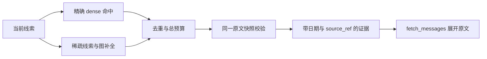

# 记忆架构

Kirakira 的事件记忆保留完整经历，再学习经历之间的联系。Akasha2 把精确向量召回与图式联想补全
合并为带时间、通道和来源的证据；模型可以继续展开原文，核对人物、对象、关系和当时的更正。
原始消息始终拥有事实，学习图和上下文都是派生状态。

Akasha2 显式 opt-in；默认结构化记忆、Akasha v1 和 Markdown 档案继续各自承担已有用途。
上游算法固定来源与 MIT 许可证，宿主的提交、回源、恢复和运行接口由 Kirakira 维护。

## 记忆材料与状态

| 材料 | 权威位置 | 职责 |
| --- | --- | --- |
| 完整对话和工具轨迹 | `sessions.db/messages` | 保存真实经历、稳定消息身份及原始时间 |
| 工作上下文 | Session compaction ledger | 为当前任务续跑生成预算内投影，保留来源边界 |
| 可编辑档案 | `memory/*.md` | 身份、偏好、近期上下文及人工维护内容 |
| Default 结构化记忆 | `memory/coremem.db` | 提取和管理事实、偏好、过程及证据 |
| Akasha v1 | 配置的 `akasha.db` | 现有图式记忆与事务学习 |
| Akasha2 | `memory/akasha2.db` | 学习图、消费位置、原文绑定和向量空间的原子快照 |

压缩和裁剪只改变模型看到的投影，不删改原始消息。图引擎消费已提交的原文消息对，不消费
compaction 摘要。Markdown 的归档进度与 context compaction 是不同状态。

## 精确回忆与联想补全



Akasha2 的 `MemoryCycle` 根据 dense、词项、时序与学习关联生成 retrieval ticket；宿主 selector
另外保留最多五个精确 dense 命中，再用 completion 填充剩余位置。两条 lane 去重后各自按时间排序。
时间、strong 和抑制规则应用于读出，分数不作为事实可信度或时间先后的替代品。

Kirakira 的 `MemoryQuery.limit` 是总记录预算。上游的 completion 预算外加精确通道，因此
本项目明确保留接口差异。历史 graph-only adapter 结果与当前双通道结果分别记录；见
[ADR0012](../decisions/0012-akasha2-dual-lane-readout.md)。

## 原文证据闭环

每条召回包含稳定 message IDs、原始日期、lane 和 `source_ref`。Akasha2 的 `source_ref` 是
user/assistant 两条消息 ID 的 JSON 列表。`fetch_messages` 直接接受该列表或单个 ID：

- 在同一只读快照中定位全部 anchor，再展开邻近消息。
- 重叠窗口去重，跨会话分组并保持会话内顺序；输出标记 `is_anchor`。
- 列表中任一原文缺失时失败，不返回看似完整的部分证据。
- 最多 64 个 anchor、每侧最多 50 条上下文；旧 `session:seq` 只解析确实存在的位置。

恢复和一次 query 的多个命中同样共用一个 SQLite 只读视图。每个原始消息对都核对学习时的内容摘要；
外部改写会在后续读取中明确失败，要求核对来源或重建。一次 query 可以返回它固定视图中的完整旧版本，
不会混合读取中途出现的新版本。这不授权修改原文，也不是跨任意外部系统的事务。

## 提交后学习与恢复

```text
原文 assistant INSERT + publication 同事务提交
  → 通知唤醒 / 后台追赶
  → 核对原文准入、稳定身份和向量空间
  → 同一个 MemoryCycle 学习
  → 图 + bindings + cursor 原子发布
```

通知只是唤醒信号，durable publication 顺序决定消费。只接纳完整、合格的原始对话消息对；
scheduler、proactive、skip 与中断消息保留原文但不教学。重复通知不会重复强化，失败阻塞后继。

Akasha2 默认每 16 条及关闭时发布 checkpoint，未发布尾部按同一周期重放；writer 独占，发布失败后
拒绝继续使用脏内存。恢复校验来源 stream、publication 顺序、原文内容和 embedding 模型/维度/端点。
固定向量离线重建不访问模型网络、不覆盖来源、不自动激活候选。

新在线向量在学习前以 float32 固定到 Session 的 `message_embeddings`，缓存键包含模型、端点
和声明维度，内容 hash 绑定实际原文。已缓存输入可跨学习失败复用；派生图丢失后，从完整源库和
固定向量重建。checkpoint 中已归一化向量按原值恢复，不再二次归一化。
旧历史不自动补算，缺失固定向量仍失败；旧 model-only 缓存重建会单独标记，不能据此证明端点身份。

显式召回不提交学习；`read_only` 不写诊断 query log。当前 adapter 没有完整上游的显式 feedback
和多 scope 图路由，具体能力范围见[当前状态](../status/current.md)。

## 服务与资源

Runtime 只借用提供者拥有的 `MemoryServices` 及能力租约。bootstrap 负责构造，memory_tools
拥有模型工具，具体引擎维护自己的消费、索引与关闭规则。工具和 Drift 不重复持有数据库 owner。

Markdown maintenance 按 session 串行收口归档；结构化提取失败不回滚已提交对话。会话的提交成功
与记忆消费成功是两个事实，不能把不同数据库的提交称为跨库原子事务。

## 验证

公开任务质量、原文保真、在线工具链、重放/故障性质和成本分别报告。合成向量只用于合同验证，
语义实验使用免费本地 BGE 与 Step5 Token Plan。共享算法的原样移植不自动继承上游质量结论。

配置与切换见[记忆手册](../handbook/memory.md)，复现见[评测手册](../operations/memory-evaluation.md)，
完整结果见[验证记录](../operations/verification.md)。
