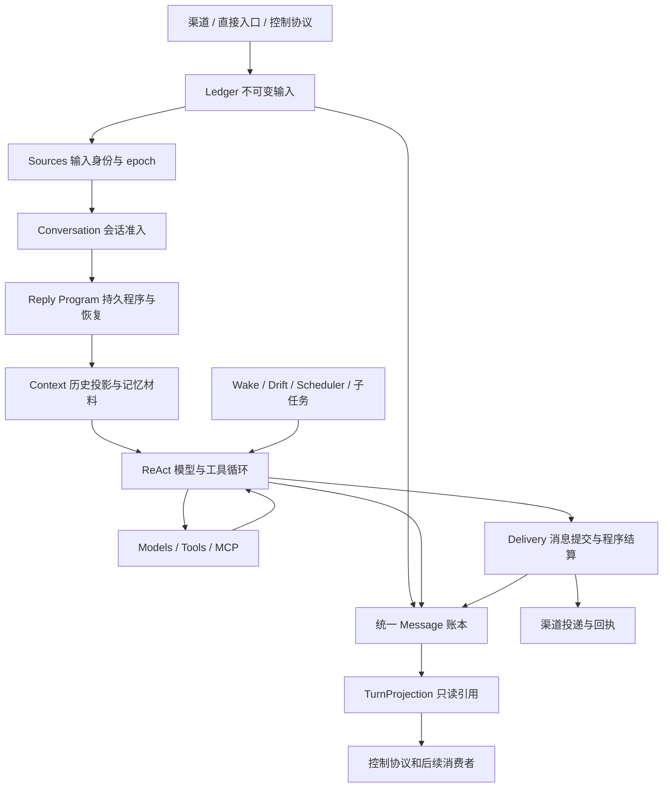

# Runtime 架构

Kirakira 使用 Akashic 的原生 Context / Fiber / Effect 内核。参考提交固定为
[`e1628ddc8a33c2840e5b4558ff3b66af207eec2a`](https://github.com/kachofugetsu09/akashic-agent/tree/e1628ddc8a33c2840e5b4558ff3b66af207eec2a)。
`agent/plugin_composition/UPSTREAM.json` 逐文件记录来源和 SHA-256，包含原样移植的内核及其直接依赖；
许可证随源码保留。`scripts/check_upstream_kernel.py` 在本地和 CI 检查字节一致性。

## 骨架与装配

`agent/plugin_composition/` 是唯一的激活、依赖和资源生命周期权威：

- `CompositionRoot` 持有一张当前依赖图；服务发布和撤销驱动消费者的局部激活。
- `Context` 属于一次确切的 Fiber activation。消费者声明 `inject`，通过 `require/get` 读取该次激活的依赖。
- `Fiber` 管理 pending、loading、active、failed、unloading、disposed 状态，以及自己的子树。
- `Effect` 在取得资源前建立所有权；按逆序清理，失败时保留责任，显式重试。
- `OwnerCall` 与 `RuntimeScope` 保护实际执行入口。旧 activation 的入口不会悄悄改绑新实例。
- `spawn` 启动 Fiber 所有的任务；退出先取消并等待任务和实际调用，再释放资源。
- 原生事件、健康状态、incident、readiness 和拓扑视图来自同一 Root。

`bootstrap/distribution.py` 只选择业务 provider。`bootstrap/runtime.py` 创建组合并交给
`Application`；Application 提供直接入口和启动/停止外观，不再另外维护一套逐服务启动、关闭流程。
`agent/composition/` 是分发声明和旧 SDK 的适配层，所有服务查找和变更都委托给原生 Root，
没有第二张依赖图或独立的代际计数。普通 provider 直接接收上游原生 Context。

显式 `start_background` 是应用层启动闸：构造 Runtime 时可以执行直接请求，后台循环和网络监听在
启动闸打开后运行。后续局部重新激活的 provider 使用相同闸门；资源仍由原生 Effect/Fiber 持有。

## 主链

| Owner | 职责 |
| --- | --- |
| `plugins/ledger` | Session、统一类型化 Message 日志、通用 owner 事务、兼容聊天历史与消息向量缓存 |
| `plugins/turn_projection` | 从 Message 计算逻辑 Turn 的消息/工具结果引用，不保存正文或消费游标 |
| `plugins/sources` | 来源 head/epoch、输入替代、会话准入与关闭排空 |
| `plugins/conversation` | 接受请求、获取准入、激活程序、处理中断与终态 |
| `plugins/reply_program` | 默认回复程序、稳定请求回执、工具效果记录、暂停和显式续跑 |
| `plugins/reply` | 渠道入站 follower、可投递的恢复工作 |
| `plugins/jobs` | 后台结果的不可变事实、逐步领取与回复同事务消费；生产者不直接发起用户消息 |
| `plugins/context` | 对话上下文、AGENTS/Skill、历史投影和压缩 |
| `plugins/react` | 共享模型/工具循环、终结策略、批次和执行结果 |
| `plugins/models` | 客户端构造、当前生成的重试和流式取消 |
| `plugins/tools` | 当前工具目录、逐生成工具菜单、实际调用和工具提供者 |
| `plugins/mcp` | 声明选择、每个连接的独立 owner、进程和实际调用排空 |
| `plugins/delivery` | 消息与程序的同库结算、投递与后续事件 |
| `plugins/extensions` | 已安装文件、原生 apply 插件、旧类式 SDK 适配、jobs/services/hooks |
| `plugins/projects` / `plugins/working_directory` | 项目默认目录和独立 Session cwd |
| `plugins/proactive_flow` / `plugins/drift_flow` / `plugins/scheduler` | 主动和定时业务，各自持有业务状态 |
| `plugins/default_memory` / `plugins/akasha` / `plugins/akasha2` | 可选择的长期记忆提供者 |

`agent/core` 和顶层 `session` 已移除。模型、工具、回复、MCP、记忆和控制业务都由各自插件包提供。
`agent/plugins/__init__.py` 只保留已有插件的公共导入入口。

Jobs 的 Session 钩子返回该次注册的撤销句柄，由原生 Effect 释放；旧句柄无法删除新激活的钩子。
子代理只注入 Jobs，不持有消息总线。子代理与 Scheduler 先暂存工具声明，再通过 `install_owned`
发布到确切 activation，撤销时移除该 owner 的贡献并排空实际调用。局部替换 Jobs 会重新激活依赖分支，
Ledger 与未读结果保持原身份，不会因遗留工具注册而激活失败。

## 持久事实与恢复

接受输入时，原始消息、来源 head 和回复程序在 `sessions.db` 同一 owner 事务中提交。
程序保存输入 ID、模型/工具授权摘要及效果记录，通过 Ledger 读取原始输入。
Session 最终消息和程序结算也在同一事务中完成；来源 epoch 和输入身份在提交时再次核对。

已保存结果的工具调用在续跑时复用结果。已开始但结果未知的操作进入 `needs_reconciliation`，
要求显式核实及依据；不会因为重启自动重放。管理入口在同一 Session 准入下执行。
渠道恢复需要已有投递订阅；直接请求保持暂停，等待明确的续跑操作。

后台子任务通过 `jobs.notices.v1` 发布结果。当前回复在每次模型请求前准备材料，领取同一 Session 的未读
结果；传输重试使用已冻结的请求，后来的结果留给下一步。空闲唤醒也先取得 Session admission，再检查
结果是否仍未领取，避免生成第二条重复回复。通知的 consumed、最终消息和程序完成在同一个 SQLite
事务提交；取消、模型拒绝或提交失败不能提前消费。重启后的 paused 程序按原身份重新取得材料。
独立 `job:<id>` 来源不伪造用户输入，默认不触发记忆学习。`spawn_manage(action="results")` 按原会话
读取结果和消费回执。旧的 `subagent-runs/result.json` 写入已移除，运行期以结果 owner 为准。

上下文压缩是历史投影，不能删除原始消息。Akasha2 算法继续固定在独立的
`d85b00c233686b68b082052b1b20123905aeab13`，本轮没有改动记忆算法或迁移旧库。

## Message 与 Turn

`ledger_messages` 在每个 Session 内分配严格递增的 `seq`；来源和作者独立，
body 使用上游的 `Input / Output / ToolResult / Control`。工具结果的 `CallRef`
指向已接纳 Output 的具体调用位置，拒绝跨会话/来源、重复结算及身份复用冲突。
输入接纳、模型批次、效果结果分别与相应程序状态在同库事务中提交。程序记录保留
lease、授权、执行意图和消息引用，正文由账本恢复；不能因引用缺失自动重做工具。

旧 `ledger_inputs` 和程序内联正文在 owner 启动时事务迁移，输入与程序 ID 保持稳定；
更早的非程序聊天及其工具链也导入 Message。旧聊天表、FTS、JSON 镜像和记忆发布序列
仍是兼容面，尚未移除。显式历史删除同时清理关联账本与程序恢复引用，运行中的程序拒绝删除。

`Steers` 由 Conversation owner 持有。暂存未接纳的文字可撤回，不创建第二份持久请求队列；
下一次模型请求前，在当前程序授权下追加 Input，同轮已执行工具保留结果。模型最后一步已结束
则接为普通后续请求，owner 退出会排空自有任务并撤回未接纳暂存。已接纳插话可跨重启续跑。
同轮多输入尚未接上记忆消费者的一问一答合同，因此保留全部原文并跳过这类 Turn 的自动学习。

控制协议提供 `turn/steer`、`turn/withdraw`、`message/list` 和 `turn/project`；
`staged=true` 表示暂存成功，消息列表出现 Input 才表示耐久接纳。`staged=false` 时调用方
仍持有原输入，可使用普通 `turn/start`。产品 UI 的完整交互还未接入。

## 热更新与范围

替换 provider 先撤销旧激活并排空，再接入当前选择；依赖消费者由原生图重新激活，无关分支保持身份。
模型替换会重建依赖它的回复程序、工具及扩展子树，Ledger 和独立 Sources 准入不因此关闭。
工具菜单只在一次模型生成内固定具体工具对象，下一次生成重新读取当前可用工具。
详见[所有权与局部更新](ownership-and-reload.md)。

## 与当前上游的架构范围

2026-10-20 核对 main `e1628dd`：原生组合内核的 23 个固定文件及直接依赖逐字节一致，
包含 Task 中断升级语义。另 10 个 Akasha2 文件保留原版本；Message 值合同来自该版上游，
TurnProjection 的合同和实现及 frozen_json 原样固定，共 37 项摘要检查。

| 层 | 当前情况 | 尚未一致的合同 |
| --- | --- | --- |
| Context/Fiber/Effect | 原生内核一致，单一 Root 和 activation 负责依赖、实际调用和资源关闭 | 不由此推出整套宿主能力一致 |
| 业务组合 | Ledger、Sources、Conversation、Reply Program、Context、ReAct、Models、Tools、MCP、Delivery 独立 owner；新增 Jobs | 材料服务和模型/内容等完整上游公共协议仍需逐步接入 |
| 持久事实 | Input/Output/ToolResult/Control 进入统一 Message 日志；ReplyProgram 保存消息引用，恢复从账本读正文；TurnProjection 原样接入 | 记忆和 compaction 仍消费兼容聊天表；附件、写入授权和完整源任务提交协议待补 |
| 同轮控制 | steer 暂存/撤回/步间输入、末步后接续；停止与恢复写 Control，已知工具结果从消息引用恢复 | 渠道/工作台的 steer 交互、latest 输入重试公共协议、Scheduler 工具边界让出 |
| 执行宿主 | 本地目录、Shell/PTY、MCP、子代理及资源排空已有 | 原生 Task、prepared 执行目标、HostBridge、Workload 与进程服务 |

整体架构尚未完全对齐。完整功能范围仍是[70 个生产插件及 3 个跨目录面](../status/akashic-features.md)，
全部模型/资源提供方和产品客户端也需继续补齐。固定内核、同名 owner 和测试数量都不是整项完成证据。
