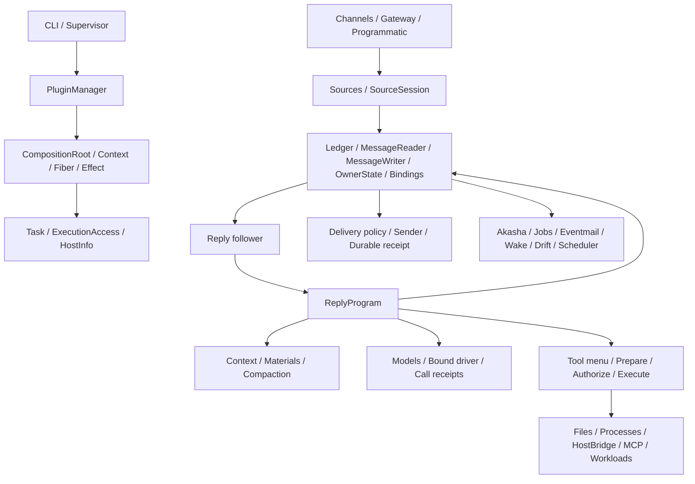

# Runtime 架构

Kirakira 以统一的任务生命周期组织对话、工具、记忆和主动执行。
原始消息保存在 Ledger，派生状态由各自的插件管理；来源与许可证集中记录在
[第三方声明](../../THIRD_PARTY.md)。

## 宿主和生命周期

`bootstrap/tools.py` 只装配宿主资源与 PluginManager。业务数据库和后台工作归普通插件。
PluginManager 固定来源制品、配置输入和公共合同，在同一个 live Root 中实施局部更新。
`contract.py` 的公共类型在进程内保持身份；私有业务模块按 generation 隔离。
外部调用模型设置等业务入口使用公开 JSON RPC，不传递其他 generation 的私有 dataclass。

Context 授权依赖和资源声明。Fiber 拥有 activation，Effect 拥有撤销和物理排空。
Task 服务按真实插件 owner 保存；来源使用 `(session_id, source)` 进行任务接纳。
任务撤权与底层工作物理退出分别处理，关闭会等待实际清理。

运行参数由插件自己的配置模型与设置服务解释，UI 的通用模型表单负责字段覆盖、恢复默认和校验展示，采用仍通过 PluginConfig 的固定输入与回执完成。已归档的程序和工具绑定不因界面修改而替换。

Web 模块在激活时拥有自己的内存资源，页面挂载只订阅当前值；模块卸载中止读取，迟到响应不能覆盖写入后的结果。缓存用量的检查点是 models 插件可丢弃、可重建的统计投影，不参与模型注册事务或实际执行授权。

## 消息、权限和恢复

Ledger 是唯一消息事实库。Input、Output、ToolCall、ToolResult 和 Control 都进入有序消息日志。
Reader 只有读取权；Writer 固定 author、source、body 类型、内容校验和可选 exact CallRef。
回复任务关闭立即释放新输出写权；已经开始的工具持有自身结果写权直至结算。
OwnerState 将各 owner 的 CAS 状态与消息提交放在同一个 SQLite 事务域。
Bindings 保存实际 provider 来源和固定业务选择，恢复时不会用当前同名工具替换旧授权。

SourceSession 先持久接纳 Input，再撤销旧任务的提交权。
Source head 校验、工具首次效果和最终输出提交共享事务顺序，取消通知不充当正确性依据。
TurnProjection 从日志恢复轮次；Reply 跟随日志并选择程序；ReplyProgram 只组合一次执行。
模型调用的重试、流重置和回执由 Models 统一拥有。工具效果身份来自持久 CallRef。

## 执行与扩展

工具先固定菜单和 binding，再准备参数、授权、提交 intent、执行并写回原调用结果。
执行目标在 prepare 阶段固定。ExecutionAccess 绑定真实 Root、代码 owner 和 generation，
只接纳由该 grant 签发的 PreparedProcess。
Host execution 提供 Files、Processes、Terminals 与 HostBridge；ManagedProcesses、MCP 和
Workloads 分别拥有实际资源及借用生命周期。Workload 的容器 controller 是可选外部设施。

模型、项目、工作目录、技能、主动交互、记忆、投递和界面都以插件声明其能力和实际依赖。
可选提供方缺席时，相应功能分支保持等待或明确不可用。

## Kirakira 装配

`kirakira_agent/runtime.py` 只选择发行版组合、初始化 workspace 并提供 Python 调用入口。
`kirakira_agent/cli.py` 将执行交给宿主 CLI。
没有旧 ConversationService、ProgramStore、自建 TurnAdmission 或另一套依赖图参与运行。
模型通过 Models driver 接入。聊天模型和 embedding 独立配置，执行程序只依赖角色、能力与固定绑定。
Akasha 消息界面由固定的前端源码和 npm lock 重建，生成摘要单独记录。

Shell 的运行修复：zsh 函数快照解析期间关闭别名展开，随后恢复原选项。
补丁和摘要在 `patches/zsh-snapshot-aliases.patch` 与 `UPSTREAM.json` 中。

## 记忆与主动交互

Markdown Memory 拥有显式档案；Akasha 从 Ledger 的完整闭段学习，原文仍由 Ledger 唯一持有。
消息向量进入可重建的 sessions-derived.db；图与消费进度一同发布到 Akasha 派生快照。
召回回执由 Ledger OwnerState 保存，只记录出处、选择与呈现范围，不复制另一份事实正文。
自动上下文、工具与程序读取共用查询逻辑；原文展开沿已有回执读取 Ledger，并留下实际调用出处。
查询会话可通过 SessionAttributes 排除学习，避免评测答案污染历史。
local-embedding 是普通 Models driver，使用本地 ONNX 权重和固定资产摘要，运行时不下载或请求现金 API。

EventMail 分别接纳 Content、Alert、Context；Wake 按兴趣池与规则决定是否执行、调查和分享。
Alert 使用真实 Delivery 回执完成结算；Content 不足以触发时记录可观察的 content_insufficient。
event-ingress 只把已认证 Gateway RPC 转到绑定来源，不另建事件队列或任务调度器。
Drift 保存提案状态并提供 Wake/Delivery 窄合同；可选的空闲思考生产端读取选定对话和同范围的记忆，使用 Models 生成带出处的候选。OwnerState 只保留规划次数、原始来源引用与交接凭据。任务领取、程序执行、工具与投递仍由既有 Drift/Wake、Sources、Task、ReplyProgram 和 Delivery 管理，没有第二套执行队列。研究继承提案的参考对话范围，收件位置独立。
不能将其源码存在表述为完整的第二主动生成流程已上线。

运行诊断和插件安装也是插件。新工作区默认选中；既有工作区使用显式 upgrade 命令，
保留其余插件选择并备份原选择。各功能启用与验证状态见[差距文档](../status/roadmap.md)。

发行构建另有 `patches/stage-web-assets.patch`：npm build 最后把 dashboard/chat 产物移入所属插件制品目录，
避免源码已更新、运行时却读取旧构建。补丁、来源摘要与本地摘要均登记在 UPSTREAM.json。

空图重建已登记 `patches/akasha-empty-rebuild.patch`：只允许合法零节点通过既有发布分支，负数仍拒绝。
旧历史的本地向量补算属于显式运维入口，只写 Ledger 派生缓存；Akasha 保持唯一学习与重建 owner。
既有工作区升级通过 prepare_plugin_input / PluginSelection CAS 更新已选输入，
不会通过删除稳定选择或重建另一张依赖图来升级。
