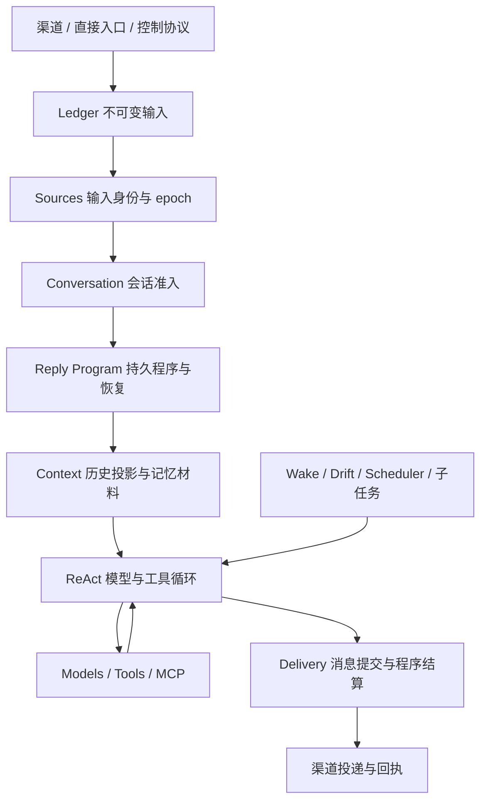

# Runtime 架构

Kirakira 使用 Akashic 的原生 Context / Fiber / Effect 内核。参考提交固定为
[`21b38f0e102d9e1bdc5576725635dce29f135c0c`](https://github.com/kachofugetsu09/akashic-agent/tree/21b38f0e102d9e1bdc5576725635dce29f135c0c)。
`agent/plugin_composition/UPSTREAM.json` 逐文件记录来源和 SHA-256，包含原样移植的内核及其直接依赖；
许可证随源码保留。`scripts/check_upstream_kernel.py` 在本地和 CI 检查字节一致性。

## 骨架与装配

`agent/plugin_composition/` 是唯一的激活、依赖和资源生命周期权威：

- `CompositionRoot` 持有一张当前依赖图；服务发布和撤销驱动消费者的局部激活。
- `Context` 属于一次确切的 Fiber activation。消费者声明 `inject`，通过 `require/get` 读取该次激活的依赖。
- `Fiber` 管理 pending、loading、active、failed、unloading、disposed 状态，以及自己的子树。
- `Effect` 在取得资源前建立所有权；按逆序清理，失败时保留责任，显式重试。
- `OwnerCall` 与 `RuntimeScope` 保护实际执行入口。旧 activation 的入口不会悄悄改绑新实例。
- `spawn` 启动 Fiber 所有的任务；退出先取消并等待任务和实际调用，再释放资源。
- 原生事件、健康状态、incident、readiness 和拓扑视图来自同一 Root。

`bootstrap/distribution.py` 只选择业务 provider。`bootstrap/runtime.py` 创建组合并交给
`Application`；Application 提供直接入口和启动/停止外观，不再另外维护一套逐服务启动、关闭流程。
`agent/composition/` 是分发声明和旧 SDK 的适配层，所有服务查找和变更都委托给原生 Root，
没有第二张依赖图或独立的代际计数。普通 provider 直接接收上游原生 Context。

显式 `start_background` 是应用层启动闸：构造 Runtime 时可以执行直接请求，后台循环和网络监听在
启动闸打开后运行。后续局部重新激活的 provider 使用相同闸门；资源仍由原生 Effect/Fiber 持有。

## 主链

| Owner | 职责 |
| --- | --- |
| `plugins/ledger` | Session、append-only 消息、不可变输入、通用 owner 事务、消息向量缓存 |
| `plugins/sources` | 来源 head/epoch、输入替代、会话准入与关闭排空 |
| `plugins/conversation` | 接受请求、获取准入、激活程序、处理中断与终态 |
| `plugins/reply_program` | 默认回复程序、稳定请求回执、工具效果记录、暂停和显式续跑 |
| `plugins/reply` | 渠道入站 follower、可投递的恢复工作 |
| `plugins/context` | 对话上下文、AGENTS/Skill、历史投影和压缩 |
| `plugins/react` | 共享模型/工具循环、终结策略、批次和执行结果 |
| `plugins/models` | 客户端构造、当前生成的重试和流式取消 |
| `plugins/tools` | 当前工具目录、逐生成工具菜单、实际调用和工具提供者 |
| `plugins/mcp` | 声明选择、每个连接的独立 owner、进程和实际调用排空 |
| `plugins/delivery` | 消息与程序的同库结算、投递与后续事件 |
| `plugins/extensions` | 已安装文件、原生 apply 插件、旧类式 SDK 适配、jobs/services/hooks |
| `plugins/projects` / `plugins/working_directory` | 项目默认目录和独立 Session cwd |
| `plugins/proactive_flow` / `plugins/drift_flow` / `plugins/scheduler` | 主动和定时业务，各自持有业务状态 |
| `plugins/default_memory` / `plugins/akasha` / `plugins/akasha2` | 可选择的长期记忆提供者 |

`agent/core` 和顶层 `session` 已移除。模型、工具、回复、MCP、记忆和控制业务都由各自插件包提供。
`agent/plugins/__init__.py` 只保留已有插件的公共导入入口。

## 持久事实与恢复

接受输入时，原始消息、来源 head 和回复程序在 `sessions.db` 同一 owner 事务中提交。
程序保存输入 ID、模型/工具授权摘要及效果记录，通过 Ledger 读取原始输入。
Session 最终消息和程序结算也在同一事务中完成；来源 epoch 和输入身份在提交时再次核对。

已保存结果的工具调用在续跑时复用结果。已开始但结果未知的操作进入 `needs_reconciliation`，
要求显式核实及依据；不会因为重启自动重放。管理入口在同一 Session 准入下执行。
渠道恢复需要已有投递订阅；直接请求保持暂停，等待明确的续跑操作。

上下文压缩是历史投影，不能删除原始消息。Akasha2 算法继续固定在独立的
`d85b00c233686b68b082052b1b20123905aeab13`，本轮没有改动记忆算法或迁移旧库。

## 热更新与范围

替换 provider 先撤销旧激活并排空，再接入当前选择；依赖消费者由原生图重新激活，无关分支保持身份。
模型替换会重建依赖它的回复程序、工具及扩展子树，Ledger 和独立 Sources 准入不因此关闭。
工具菜单只在一次模型生成内固定具体工具对象，下一次生成重新读取当前可用工具。
详见[所有权与局部更新](./ownership-and-reload.md)。

内核字节一致性、业务拆分和全部上游功能完成是不同的验收项。完整功能范围仍是
[70 个生产插件及 3 个跨目录面](../status/akashic-features.md)；其中后台结果注入、完整执行宿主、
全部模型/资源提供方和产品客户端仍需继续补齐。不能从固定内核或测试数量推导功能全部完成。
