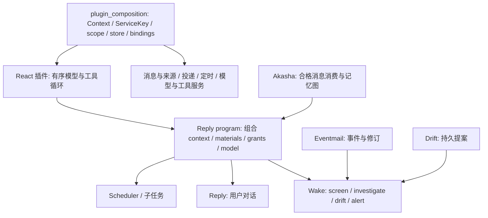

# Kirakira 重构审计：主动性、记忆与 Runtime

审计日期：2026-10-02。本文是设计分析，不是质量 benchmark。测试证据集中在[验证记录](../operations/verification.md)。

## 结论

Kirakira 的核心问题不是少几个 Tool、MCP 或渠道，而是亮点还没有变成足够坚实、可验证的运行合同：
什么时候主动、为什么值得打扰、哪些历史能作为证据、一次失败或重复执行会不会改变记忆。
继续按上游目录补功能，只会得到一个规模更大的复刻品。

建议把项目定位收敛为**具备可审计主动决策和可重放长期记忆的个人 Agent Runtime**。
本轮继续对齐 Akashic 的工程原则，保留 Akasha v1 数学内核，先修正执行、学习、恢复边界；
是否换 v2 由同预算消融决定。不能把这次改动称为完整 Akasha2，也不能声称已完全追平最新 Akashic。

## 审计对象与来源

| 项目 | 本次实际阅读版本 | 用途 |
| --- | --- | --- |
| Kirakira | 本地 `main` 起点 `b6c4143` | 当前实现；不是对远端最新提交的保证 |
| Akashic | `0be132326ee6c410d1b2eaa85c09e1b50dcc5a9e` | 2026-10-02 最新拉取快照 |
| Maka | `c7fa6bb6a5f3731f1f591dbeb60433fba79ccb6e` | 原 maka-agent 仓库现重定向至 apache/maka |
| DeepSeek Harness | `639ed015397290b3745d163aafe02ffee4aa3f84` | dsh 0.2.0-rc.2 对应快照 |

Akashic 的旧手册和 ADR 有历史残留，以下涉及“当前”的判断优先服从这个 pin 的生产代码。
原 Kirakira 文档中的对齐点 `ac6f7652` 是八月基线，不能再代表十月的上游。

## 1. Kirakira 的差距，尤其是双主动交互和记忆

“双主动”应解释为两种驱动力：外部事件驱动的分享/提醒，以及内部未完成意图驱动的探索。
Alert/Content/Context 是数据职责划分，不是三种同等的主动意识。轮询和随机唤醒也只是调度，不能证明主动决策质量。

| 维度 | 重构前 Kirakira 的具体问题 | 最新 Akashic 的方向 | 本轮处理 |
| --- | --- | --- | --- |
| 执行链 | 被动 DefaultReasoner、主动单次模型 JSON 判别、Drift 同步 Agent 分离 | Reply program 组合共享的有序 ReAct | 三者共用 DefaultReasoner；后台通过 scoped 入口 |
| 决策权限 | 解析自然语言中的 JSON；无明确终结动作合同 | 确切批次和工具授权，share/skip 终结动作 | share_content/share_alert/skip_content；候选 ID 严格验证，冲突批次整体拒绝 |
| 候选准入 | 本轮 new_content 与冷却耦合，冷却期间新事件可能永远失去判断机会 | Eventmail 持有事件事实，Wake 选择/质量池独立 | 持久 pending/check/retry 状态；重启后仍可判断；不是完整质量池 |
| 主动可解释性 | 有 tick trace，但很难还原“看到了什么、为什么发” | 固定阶段输入、程序绑定、消息来源和决策 | 保存候选、prompt、模型、工具轨迹、决策及投递状态 |
| 内部主动性 | 最久未运行 Skill + hazard + scratchpad | Drift 是持久 proposal owner，由 Wake 选择和结算 | 保留现有 Skill 产品语义；统一执行，必须 finish 后才提交草稿 |
| 学习时机 | 查询激活与学习耦合，兴趣扫描/显式 recall 可能影响图状态 | retrieve ticket 与 commit 分离，统一 online/rebuild cycle | 查询不学习；只消费完整持久消息对 |
| 身份和重试 | 通过内容匹配最近消息；重复通知可能重复学习 | 来源身份、消费账本、图状态一起发布 | 稳定消息 ID、原子图/收据、重复幂等、冲突失败 |
| 重放 | 有 replay 算法，但与线上路径、可见消息范围可能不一致 | 明确 admission、固定向量、持久 consumption provenance | 同一学习 cycle；只见历史前缀的 dense/FTS/IDF；独立新库发布 |

Akashic 的内容池值得学习的不是“多写一个评分 prompt”。其 ADR0049 将一次到达的质量映射为初始质量量值，
结合发布时间置信度、资格和时间衰减累积成池；新到达打开判断机会，旧积累支持判断，不能靠频繁轮询反复抽奖。
维护与模型回合解耦，消耗和来源修订的 CAS 也有明确 owner。Kirakira 本轮实现的是更小的持久候选状态机，
仍缺这套质量池、来源 revision 合同和校准实验。
[来源：Wake pool](https://github.com/kachofugetsu09/akashic-agent/blob/0be132326ee6c410d1b2eaa85c09e1b50dcc5a9e/plugins/wake/pool.py)、[ADR0049](https://github.com/kachofugetsu09/akashic-agent/blob/0be132326ee6c410d1b2eaa85c09e1b50dcc5a9e/docs/decisions/0049-wake-content-is-a-decaying-eventmail-pool.md)。

## 2. Akashic 当前 Agent Core

现在的 Akashic 不适合画成“一个超级 AgentLoop 加几个插件”。它把组合设施、执行器、业务程序和状态 owner 分开：

`OrderedReact` 的参数明确表达 reader/writer、model、projection/materials、content、tools、预算、
terminal tools、capture scope 和开始检查等。它面向有序消息和授权能力，不需要认识 RSS、提醒或音乐话题。
`plugins/react` 本身就是普通插件；未完成工具调用的 receipt、输入/输出/工具结果、读取集合、输出前的
supersession 检查，服务于“这一结果仍然对应那个输入和权限”的合同。
[来源：React 合同](https://github.com/kachofugetsu09/akashic-agent/blob/0be132326ee6c410d1b2eaa85c09e1b50dcc5a9e/agent/plugin_contracts/react.py)、[实现](https://github.com/kachofugetsu09/akashic-agent/blob/0be132326ee6c410d1b2eaa85c09e1b50dcc5a9e/plugins/react/plugin.py)。

`reply_program` 负责把模型绑定、上下文材料、工具授权、来源准入和 writer 权限组合起来。
Wake 的 Request 保存阶段输入、规则、来源事件和绑定身份；各阶段有不同预算与终结工具。
普通模型输出没有自行向用户发送的权限，真正的分享必须经过所属 owner。
[来源：Reply program](https://github.com/kachofugetsu09/akashic-agent/blob/0be132326ee6c410d1b2eaa85c09e1b50dcc5a9e/plugins/reply_program/program.py)、[Wake Request](https://github.com/kachofugetsu09/akashic-agent/blob/0be132326ee6c410d1b2eaa85c09e1b50dcc5a9e/plugins/wake/request.py)、[Wake program](https://github.com/kachofugetsu09/akashic-agent/blob/0be132326ee6c410d1b2eaa85c09e1b50dcc5a9e/plugins/wake/program.py)。

相对于常见助手的“聊天 Session + Tools + 定时任务”，它独特的地方是：持续生活经历、主动发起动作、
内部提案、兴趣与长期记忆共享一套来源和执行语义。相对于 workflow 编排器，它不以预定义任务 DAG 作为
产品核心。这里是架构取向比较，不代表其他 harness 一概缺少持久化或权限控制。

Kirakira 本轮的 `run_scoped` 只共享执行内核和工具限制，不是整个插件微内核的移植：
后台不自动拥有持久消息日志、compaction、跨进程恢复或完整 MCP 组合能力。应继续让 owner 管状态，
不能为了名字一致再包一层空洞的“Program”。

## 3. 要不要做 Akasha2

**不建议立即为版本号整体重写；建议先采用它的正确性合同，再用质量证据决定算法替换。**

Akasha v1 已经有向量种子、联想扩散、时间与资源因素、边强化。v2 的差别不只是公式更多：
它在 domain 层统一稀疏特征和扩散状态，在 application 层分开 retrieve/commit，在 infrastructure 层
处理固定向量、图快照与消费来源。domain 默认参数可以看到 restart 0.25、activation power 2、
recurrent budget 1 和 reverse temporal ratio 0.25 等；这些是具体建模选择，不能直接当作质量优势。

v2 消费者把 applied/skipped provenance 与图一起提交；同一来源重试不再学习；写入租约、绑定/向量身份、
发布失败后的 poisoned 状态和取消等待都在处理长期运行的一致性。当前源码的 rebuild 对缺失固定向量
可以生成显式 skip 记录，不能机械沿用旧 ADR 的“所有缺失一律 abort”。恢复也不是每次启动重学全历史。
Session scope 有 global/isolated/off 路由；这是明确的记忆准入，不只是查询时加一个 session 字符串。
[来源：Akasha 应用层](https://github.com/kachofugetsu09/akashic-agent/tree/0be132326ee6c410d1b2eaa85c09e1b50dcc5a9e/plugins/akasha/application)、[领域层](https://github.com/kachofugetsu09/akashic-agent/tree/0be132326ee6c410d1b2eaa85c09e1b50dcc5a9e/plugins/akasha/domain)、[scope ADR](https://github.com/kachofugetsu09/akashic-agent/blob/0be132326ee6c410d1b2eaa85c09e1b50dcc5a9e/docs/decisions/0073-session-scope-routes-akasha-graphs.md)。

面试可以分三层讲，不需要从公式开始：

1. 原始消息才是事实；向量召回找到字面/语义相近的经历，关联扩散恢复跨会话间接相关经历。
2. 查询只是观察。完整交互提交后才学习，而且一次历史只能被学习一次；线上与重放走同一函数。
3. 扩散为何需要重启、出边预算、竞争和遗忘：防止越扩越宽、热门节点吞噬结果和陈旧经历永久占优。

如果这些机制的效果无法用消融说明，就算能推公式也不构成项目贡献；反过来，能展示重启前后、故障重试、
证据溯源和质量/成本权衡，v1 也能讲出深度。不得把上游提出的记忆算法包装为自己的原创。
Akasha2 明确记录其算法源仓库与 commit，这种来源记录本身就值得照做。
[来源：UPSTREAM.json](https://github.com/kachofugetsu09/akashic-agent/blob/0be132326ee6c410d1b2eaa85c09e1b50dcc5a9e/plugins/akasha/UPSTREAM.json)。

迁 v2 的进入条件：相同 embedding、原始历史、时间边界和输出预算下，dense-only、v1 dense+ripple、v2
三组比较；跨会话间接召回和知识更新有稳定收益，噪声/延迟/维护代价可接受；持久化与回放故障测试同样通过。
实验设计见[记忆评测](../operations/memory-evaluation.md)，目前没有可声称的质量提升数字。

## 4. Akashic、Maka、DeepSeek Harness 各自做什么

| 项目 | 首要问题 | 关键工程方向 | 对 Kirakira 的借鉴 |
| --- | --- | --- | --- |
| Akashic | 个人助手如何连续存在并适时主动 | 消息来源、主动阶段、提案、长期记忆、scope 与绑定 | 主动决策和记忆消费的合同 |
| Maka | 多入口任务工作台如何可靠执行、恢复和评测 | 每个 State Root 单一 Runtime Host 权威，事件日志、session/child 图、权限和续跑、实验 attempt | 不确定副作用不盲重试；一次工作有一个执行 owner；评测可追溯 |
| DeepSeek Harness | 如何组合、替换和复用 Agent 执行环境 | Cordis 插件、作用域注册/撤销、profile/bundle 有序配置、provider seam、持久/临时事件、Session JSONL 版本世代 | 让模型、文件/进程世界和 UI 可替换；扩展点具有生命周期 |

Maka 的桌面/TUI/CLI/bot/eval 都作为 Host 客户端，而不是每个入口各自启动一套 Agent 真相源；
它关注用户中断、进程重启、权限续接和执行中的不确定性。评测按 task×repeat×subject 组织 cell/attempt，
避免把多次尝试里最好的结果冒充唯一一次结果。
[来源：Maka 架构](https://github.com/apache/maka/blob/c7fa6bb6a5f3731f1f591dbeb60433fba79ccb6e/ARCHITECTURE.zh-CN.md)。

DeepSeek Harness 的插件化深入 Agent loop、Session、Model、Tools、Sandbox 和 UI；
provider 的声明/提供/消费，以及插件 scope 的生命周期，是其可组合性的基础。
这并不自动提供 Akashic 式的长期兴趣学习或人格连续性。
[来源：DSH 架构](https://github.com/deepseek-ai/deepseek-harness/blob/639ed015397290b3745d163aafe02ffee4aa3f84/docs/architecture.zh.md)。

因此 Kirakira 不应同时竞争通用工作台、通用插件框架和完整个人助手产品面。建议只聚焦一个可证明命题：
**历史经历能否让主动交互更有用，同时减少无价值打扰？**
例如用户曾在多个会话谈独立音乐，系统看到演出信息：显示本次候选、相关原文证据、当前忙闲/冷却、
share/skip 理由、最终 ACK 和后续反馈；重放同一输入能复查这次决策，而不会额外强化兴趣。
再对照“无记忆”“只 dense”“dense+ripple”，这个实验比罗列十种接口更有辨识度。

## 5. 最值得学习的思想与代码习惯

- **先定义真相源和 owner。** 原始消息、事件修订、提案、投递结果各由一个 owner 写；Context 是投影，不能反向改历史。
- **将可见性和权限分开。** prompt 没列工具不等于执行器能信任 provider；每次执行仍检查 grant，且批次中途也要检查。
- **确定性包围不确定性。** 模型可以判断价值，系统负责候选资格、来源 ID、预算、终结动作、事务与重试。
- **把失败当成状态。** 缺失向量、旧绑定、未完成工具调用、未确认投递不能都吞掉成为“无结果”。
- **同一个生产函数承担 replay。** 不能维护一个看起来相似的 eval 专用算法，然后拿它证明线上正确。
- **测试不变量，不测试目录好看。** 故障回滚、重复消费、跨 session 身份、未来信息泄漏、非法工具批次，比接口存在更有价值。
- **文档服从代码并固定版本。** ADR 解释取舍，当前状态列边界，验证记录列证据；上游某份旧手册不代表今天。
- **记录来源但保留独立判断。** 对齐机制并明确修改，不复制上游所有产品面、私有运维设施或已退役兼容层。

## 本轮交付及简历表述

执行与持久化的具体合同见 [ADR0006](../decisions/0006-shared-reasoning-and-committed-memory.md)。
本轮没有替换实际用户数据库，没有调用收费 provider，也没有发布或 push。

可按实际完成情况把简历的两个亮点改成：

> 基于开源 Akashic 架构实践重构持续运行的个人 Agent Runtime，将被动对话、事件主动判断与空闲技能执行统一到共享 ReAct 执行链；通过受限工具授权、持久候选状态和显式终结动作约束主动投递。
>
> 以原始消息为事实源，结合向量召回与关联扩散；实现提交后学习、稳定消息身份、图更新与消费收据的原子事务，并让线上学习和离线重建共用同一执行周期，覆盖重复通知、故障回滚和重启续接。

这些是可从代码与测试说明的工程贡献。质量提升、v2 parity、跨进程自动续跑仍不能写成已完成。
简历日期应对应实际投入时间；十月完成的改动不应倒写为八月已经交付。
