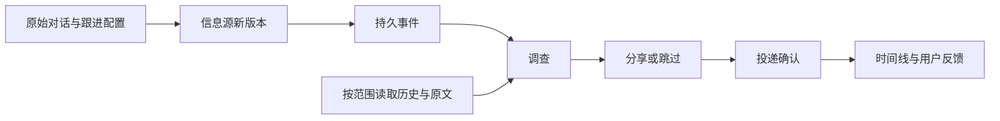

# 从对话建立持续跟进

把已经讨论过的事接着跟下去：选择原始对话、接入信息源，之后的新变化由 Agent 调查，再决定分享还是跳过。可以核对原文、调查记录、实际投递和自己的反馈。

例如，你先讨论某个项目的升级限制，后来在另一个对话更正了安排。发布源出现缓存格式变化后，Agent 应结合更正后的安排提醒；只改文档排版的更新可以跳过。

## 开始使用

先按[启动指南](start.md)配置聊天模型，并按[记忆与主动交互](memory-proactive.md)配置本地向量和通知位置。已有工作区先执行指南中的 `upgrade`，再启动 gateway。

在工作台打开一个已经发送过消息的对话，进入右侧工具区的 **跟进**：

1. 填写名称和关注内容，例如“关注会影响离线数据的格式变化；文案更新可以跳过”。
2. 选择来源类型，输入 RSS / Atom、GitHub 仓库或普通网页地址。订阅模式下仓库地址会转为发布源，例如 `https://github.com/python/cpython/releases.atom`。
3. 选择 1—6 条当前对话中自己发送的原始消息，作为最初关注的依据。
4. 选择检查间隔和调查方式，点击 **开始跟进**。

网页模式默认关注正文，忽略导航、页脚、脚本和隐藏内容。可以选填 XPath 缩小到价格、公告或申请要求区域，例如 `//*[@id='pricing']`。每次变化带有前后差异和两个版本的摘要；价格从 100 改为 80 后又恢复 100，仍会作为一次新变化处理。区域消失、无法解析或超过 24,000 字符时显示读取失败，保留上次成功基线；不会把登录页或抓取失败当成内容删除。

首次成功读取只建立基线，已有条目不会突然变成一批历史通知。之后新条目或同一条目的内容变更会进入处理。首次读取失败会重试，直到成功建立基线。

两种调查方式：

| 方式 | 适合的情况 | 行为 |
| --- | --- | --- |
| 逐条调查 | 已明确要求跟进的项目或事项 | 每个新版本请求一次调查；Agent 仍可跳过，不直接要求发送 |
| 兴趣筛选后调查 | 较宽泛的信息源 | 先经过近期兴趣判断，兴趣不足时可能不会开始调查 |

逐条调查是默认选择。用户的明确请求独立于语义相似度；系统保留原始兴趣分，不把它改成高分。缺少发布时间的信息仍保留其真实缺失状态，不补造发布时间。

## 核对结果

打开一个跟进，可以查看：

- 最初选择的原始对话及记录时间。
- 信息源的新内容和对应链接。
- 成功记录的调查决定，包括分享正文或跳过理由。
- 记忆工具实际呈现的材料，以及继续展开原文的范围。
- 精确对应到本条信息的投递确认。

“已送达”来自持久化投递确认，不表示用户已经阅读。只有确认送达的条目才能评价 **有用** 或 **与我无关**。反馈保留对应的通知身份；当前用于检查与统计，不会自动改变记忆权重或模型策略。

**暂停采集** 停止后续抓取，已经进入调查的更新仍可能完成。**现在检查** 与后台采集共用同一把锁；暂停返回后再检查，不会新发起 HTTP 抓取。

界面展示最近 100 个接纳版本；较早的事件、原始消息与投递事实仍由各自的持久化服务保留。一个工作区最多建立 100 个跟进，检查间隔为 1 分钟至 24 小时。

## 项目与记忆范围

跟进继承创建它的对话范围。通知可以统一发到另一个收件对话，调查仍按发起对话的范围读取记忆。

如果项目配置了隔离记忆，调查会话继承其项目范围；隔离项目的记忆不会因为通知改发到公共收件对话就切换为全局图。若该范围禁止召回，记忆工具继续受该策略约束。

原始关注依据不会随之后的更正而改写。Agent 需要核对消息时间、事项和更正关系，按当前安排判断。原始消息、召回、网页都保留为证据材料，不能自行扩大工具或发送权限。

绑定历史对话的跟进，在本次调查成功读取记忆前，不能提交分享或跳过决定；旧阶段的读取和其他工具的结果不能满足前置条件。记忆不可用时，只允许记录无法核实的跳过。这个检查约束执行顺序；最终判断是否正确，仍由原文和实际结果验收。

调查阶段要求结构化工具决定，并在成功的终止工具后结束。普通回答不会被当成分享或跳过。跟进逐条冻结本轮候选，其他项目和已经处理的条目不复制进这次任务。

## 接入与恢复

采集支持 RSS 2.0 / Atom、GitHub 发布订阅与无需登录的静态 HTML 网页。网页不执行 JavaScript，不接管已登录浏览器；动态渲染、验证码和真实邮箱账户尚需专门接入。网络、解析错误会记录状态并退避重试；新内容或差异每条最多保留 6,000 字符供初步调查，完整网页由调查工具按需读取。



配置、采集进度和反馈使用原生 OwnerState；接纳的内容归 EventMail，原始对话与工具结果归 Ledger，确认送达归 Delivery。没有另一套任务队列或记忆事实库。

网页采集游标额外保留上一次成功的正文快照，用于比较变化；接纳后的差异和版本摘要仍由事件系统持久化。HTTP 缓存命中或正文未变化不会新开调查。

采集在事件系统返回持久回执后才推进游标。若进程在两个提交之间中断，恢复时先查原回执；即使源站已经移除条目，也能恢复已接纳内容的引用。界面通过运行中的只读快照查询状态；离线交接核验保留独立入口。

## 程序接入

本机 SDK 使用同一套 RPC 和权限：

```python
from uuid import uuid4
from kirakira_agent.client import AsyncClient

# 在重试循环外分配一次：watch_id = "w_" + uuid4().hex
async def watch(workspace, session_id, original_message_id, feed_url, watch_id):
    async with await AsyncClient.for_workspace(workspace) as client:
        return await client.request("followups/create", {
            "watch_id": watch_id,
            "session_id": session_id,
            "name": "项目发布跟进",
            "purpose": "关注影响离线数据的兼容性变化，文案调整可跳过。",
            "url": feed_url,
            "anchors": [original_message_id],
            "interval_seconds": 900,
            "review_mode": "each_update",
        })
```

| RPC | 参数 |
| --- | --- |
| `followups/overview` | `session_id`，列出可选原始消息与当前对话的跟进 |
| `followups/create` | 上面的配置；相同身份、相同配置重试返回原记录 |
| `followups/poll` | `watch_id`，立即检查 |
| `followups/timeline` | `watch_id`，读取当前状态与最近事件 |
| `followups/set-enabled` | `watch_id`、`enabled`，暂停或恢复采集 |
| `followups/feedback` | `watch_id`、`item_id`、`revision`、`value`，评价已送达条目 |

`value` 为 `useful` 或 `irrelevant`。事件调查的固定工具不包含创建跟进；创建来自工作台或经认证的 API，需要当前对话的真实用户消息。配置身份固定，改变来源或关注理由时建立新的跟进，旧记录可以暂停。

网页配置额外传 `source_kind="webpage"`，可选 `xpath`；缺省为 `source_kind="feed"`。同一个原始地址在网页模式下不会自动改成 GitHub 发布源。
