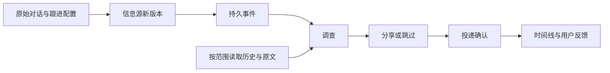

# 从对话建立持续跟进

把已经讨论过的事接着跟下去：选择原始对话、接入信息源，之后的新变化由 Agent 调查，再决定分享还是跳过。可以核对原文、调查记录、实际投递和自己的反馈。

例如，你先讨论某个项目的升级限制，后来在另一个对话更正了安排。发布源出现缓存格式变化后，Agent 应结合更正后的安排提醒；只改文档排版的更新可以跳过。

## 开始使用

先按[启动指南](start.md)配置聊天模型，并按[记忆与主动交互](memory-proactive.md)配置本地向量和通知位置。已有工作区先执行指南中的 `upgrade`，再启动 gateway。

## 直接在聊天里交办

Web 和 Telegram 的普通对话都可以使用跟进工具。可以像交办其他事情一样说：

- “持续关注这个展览公告页 `<网址>`，只在周末开放、票价符合我预算时通知，每小时检查一次。”
- “我在这个对话里安排了哪些跟进？刚才那条消息为什么通知我，实际发出了吗？”
- “修改展览的规则：之后只有票价不超过90元且周末开放才通知。”
- “先暂停这个展览的跟进，保留记录。”之后可以要求恢复。

Agent 自动绑定本轮的原始用户消息和当前对话，查询时使用实际跟进状态、调查决定、记忆出处和投递回执。
修改关注规则保留本轮用户原话及规则版本；模型的概括不能替代这份规则。
同一次操作重试读取原提交回执，不会让旧的暂停请求覆盖后来的恢复。

首次使用需要在 **主动联系** 设置中启用功能、选择通知位置，并完成模型和记忆配置。
聊天工具会核对当前状态；未就绪时说明原因，本次不创建或恢复跟进。
通知沿用主动联系设置中选定的位置，不会因为换到 Telegram 交办就自动更换收件位置。
创建成功表示已经登记，首次成功读取只建立基线；调查完成和实际送达另有状态。

聊天入口支持订阅源、静态网页和已经连接的只读邮箱；邮箱凭据仍在账户设置中填写。
当前只能管理本对话创建的跟进，后台调查不能自行创建或扩大持续关注。
按新规则复查旧内容、评价通知和重建邮箱基线仍从工作台操作。
暂停停止后续采集，已进入调查的更新仍可能完成。

一次性阅读网页、整理文件使用普通工具；“十分钟后提醒我”使用定时任务。
它们都可以从聊天交办，只有明确要求持续关注时才建立跟进。

## 在工作台建立和管理

在工作台打开一个已经发送过消息的对话，进入右侧工具区的 **跟进**：

1. 填写名称和关注内容，例如“关注会影响离线数据的格式变化；文案更新可以跳过”。
2. 选择来源类型，输入 RSS / Atom、GitHub 仓库或普通网页地址，或选择已连接的邮件账户。订阅模式下仓库地址会转为发布源，例如 `https://github.com/python/cpython/releases.atom`。
3. 选择 1—6 条当前对话中自己发送的原始消息，作为最初关注的依据。
4. 选择检查间隔和调查方式，点击 **开始跟进**。

网页模式默认关注正文，忽略导航、页脚、脚本和隐藏内容。可以选填 XPath 缩小到价格、公告或申请要求区域，例如 `//*[@id='pricing']`。每次变化带有前后差异和两个版本的摘要；价格从 100 改为 80 后又恢复 100，仍会作为一次新变化处理。区域消失、无法解析或超过 24,000 字符时显示读取失败，保留上次成功基线；不会把登录页或抓取失败当成内容删除。

## 只读邮件跟进

在跟进页点击 **连接只读邮件账户**，或从设置打开 **邮件账户**：

1. 开启邮件账户，填写 IMAP 服务器、TLS 端口、邮箱账号，以及邮箱服务商提供的应用密码或访问令牌。
2. 选择应用密码或 OAuth2 访问令牌认证。保存时会验证 TLS、账号与默认收件箱的只读访问；成功后采用配置。
3. 回到当前对话的 **跟进**，选择 **邮件**，再选择账户、文件夹、可选的精确发件地址与主题关键词。
4. 选择原始讨论并说明何时值得提醒。例如“只提醒符合我已确认预算的候选”“改期和取消要提醒，普通进度可以跳过”。

当前可连接一个账户。默认文件夹是 `INBOX`；其他文件夹使用服务商实际提供的名称，支持中文名称。发件地址和主题筛选一起生效，均匹配后才读取正文；地址匹配是过滤条件，不等同于验证发件人身份。

首次成功读取记录当前 UID 水位，已有邮件不会补成一批通知。之后每批扫描最多 10 封，存在积压时继续分批推进。文件夹、账户、UIDVALIDITY 与 UID 标识采集进度，不能用会变化的邮件序号替代。断线或读取失败保留旧水位；接纳事件的持久回执确认后才推进。

同批中具有相同邮件线程根的更新合并调查，按接收顺序处理更正，优先呈现较新的内容；不同批的新回复会成为该线程的新版本。最近 4,096 个邮件内容摘要用于识别重复副本，原生 UID 检查点继续负责重连重试。采集只使用 `EXAMINE` 和 `BODY.PEEK` 等读取操作，不标记已读、不移动或删除邮件，也不发送回复。

邮箱 UID 身份变化时会明确停止采集。检查来源后，可以点击 **重建邮箱基线**：已有事件和投递记录保留，当前已有邮件不补发，从之后的新邮件继续跟进。

凭据放在原生权限受限的私有凭据目录，配置只保留固定引用；不会加入邮件事件、记忆材料或模型提示。更新同一账户的凭据可沿用检查点；更换服务器、端口或账号会获得新账户身份，旧跟进不会悄悄读取新账户。

OAuth2 当前接收已有访问令牌，不提供浏览器授权和自动刷新；令牌过期需重新更新。不会执行邮件附件；单封读取上限为 64 KiB，初步呈现和同批线程材料有 6,000 字符预算，响应保留节选标记。明显验证码与带凭据参数的链接尽力隐藏，这不是完整的敏感信息识别或外部邮件授权机制。

技术语义以 [Python IMAP 客户端](https://docs.python.org/3.14/library/imaplib.html)与 [IMAP 标准](https://www.rfc-editor.org/rfc/rfc9051.html)为依据。真实服务商账户仍需按其登录与权限要求单独验收。

## 修改后续关注规则

打开已有跟进，直接修改 **当前关注规则** 并保存。例如原来想收到全部进度，后来改为“只有需要我决定、补材料或有截止时间时才提醒”。

修改文字作为原始用户输入写入 Ledger，原子提交规则版本与消息引用；重试不会生成两条修改，旧版本提交会提示刷新。时间线保留修改记录，新采集的事件携带采用的规则版本和原始消息引用。

调查会核对本次采用的规则原文、来源和版本，独立于按相关性搜索经历。显式修改不必等待记忆图重新学习，也不会因旧经历更相似而失效；其他历史约束仍通过记忆读取核实。结果卡片显示它实际采用的规则，方便区分修改前后的决定。

修改影响之后采集的新变化，已经接纳的调查可能继续按原规则完成。**有用／与我无关** 仍是结果评价；它不会被悄悄推断成永久规则。需要改变后续行为时，使用明确的规则修改。

邮件、网页等外部正文不会写入这份用户规则，也不能扩大调查的工具或投递权限。原始讨论与规则修改都保留，最初的关注依据不会被新规则覆盖。

### 用当前规则复查旧内容

如果原来跳过的候选在新条件下值得再看，修改规则后，在原结果上点击 **按当前规则复查**。例如，原来预算 90 元而跳过了 110 元的图书，现在确认预算变为 130 元，可以重新判断这条原信息。

复查沿用已保存的原始内容、发布时间和邮件身份，生成带有新规则版本的调查；旧判断保留，不会伪装成刚收到的新邮件。相同内容与同一规则重复点击复用已有回执，不重复调查和投递。来源已经出现更高版本时，应查看最新版本；界面最近 100 条之外的内容不能从这个入口复查。

暂停采集期间也能手动复查，不会因此恢复采集。复查可能按新规则产生一条新通知，它是用户明确请求的重新判断，不是撤回已经发送的旧通知。该操作不修改收件位置或工具授权。

## 选择调查方式

首次成功读取只建立基线，已有条目不会突然变成一批历史通知。之后新条目或同一条目的内容变更会进入处理。首次读取失败会重试，直到成功建立基线。

两种调查方式：

| 方式 | 适合的情况 | 行为 |
| --- | --- | --- |
| 逐条调查 | 已明确要求跟进的项目或事项 | 每个新版本请求一次调查；Agent 仍可跳过，不直接要求发送 |
| 兴趣筛选后调查 | 较宽泛的信息源 | 先经过近期兴趣判断，兴趣不足时可能不会开始调查 |

逐条调查是默认选择。用户的明确请求独立于语义相似度；系统保留原始兴趣分，不把它改成高分。缺少发布时间的信息仍保留其真实缺失状态，不补造发布时间。

## 核对结果

打开一个跟进，可以查看：

- 最初选择的原始对话及记录时间。
- 信息源的新内容和对应链接。
- 成功记录的调查决定，包括分享正文或跳过理由。
- 记忆工具实际呈现的材料，以及继续展开原文的范围。
- 精确对应到本条信息的投递确认。

“已送达”来自持久化投递确认，不表示用户已经阅读。只有确认送达的条目才能评价 **有用** 或 **与我无关**。反馈保留对应的通知身份；当前用于检查与统计，不会自动改变记忆权重或模型策略。

**暂停采集** 停止后续抓取，已经进入调查的更新仍可能完成。**现在检查** 与后台采集共用同一把锁；暂停返回后再检查，不会新发起 HTTP 抓取。

界面展示最近 100 个接纳版本；较早的事件、原始消息与投递事实仍由各自的持久化服务保留。一个工作区最多建立 100 个跟进，检查间隔为 1 分钟至 24 小时。

## 项目与记忆范围

跟进继承创建它的对话范围。通知可以统一发到另一个收件对话，调查仍按发起对话的范围读取记忆。

如果项目配置了隔离记忆，调查会话继承其项目范围；隔离项目的记忆不会因为通知改发到公共收件对话就切换为全局图。若该范围禁止召回，记忆工具继续受该策略约束。

原始关注依据不会随之后的更正而改写。Agent 需要核对消息时间、事项和更正关系，按当前安排判断。原始消息、召回、网页都保留为证据材料，不能自行扩大工具或发送权限。

绑定历史对话的跟进，在本次调查成功读取记忆前，不能提交分享或跳过决定；旧阶段的读取和其他工具的结果不能满足前置条件。记忆不可用时，只允许记录无法核实的跳过。这个检查约束执行顺序；最终判断是否正确，仍由原文和实际结果验收。

调查阶段要求结构化工具决定，并在成功的终止工具后结束。普通回答不会被当成分享或跳过。跟进逐条冻结本轮候选，其他项目和已经处理的条目不复制进这次任务。

## 接入与恢复

采集支持 RSS 2.0 / Atom、GitHub 发布订阅、无需登录的静态 HTML 网页及经用户配置的只读 IMAP 邮箱。网页不执行 JavaScript、不接管已登录浏览器；动态页面和具体账户服务商仍需单独验收。网络、解析错误会记录状态并退避重试；新内容或差异每条最多保留 6,000 字符供初步调查，完整网页由调查工具按需读取。



配置、采集进度和反馈使用原生 OwnerState；接纳的内容归 EventMail，原始对话与工具结果归 Ledger，确认送达归 Delivery。没有另一套任务队列或记忆事实库。

网页采集游标额外保留上一次成功的正文快照，用于比较变化；接纳后的差异和版本摘要仍由事件系统持久化。HTTP 缓存命中或正文未变化不会新开调查。

采集在事件系统返回持久回执后才推进游标。若进程在两个提交之间中断，恢复时先查原回执；即使源站已经移除条目，也能恢复已接纳内容的引用。界面通过运行中的只读快照查询状态；离线交接核验保留独立入口。

## 程序接入

本机 SDK 使用同一套 RPC 和权限：

```python
from uuid import uuid4
from kirakira_agent.client import AsyncClient

# 在重试循环外分配一次：watch_id = "w_" + uuid4().hex
async def watch(workspace, session_id, original_message_id, feed_url, watch_id):
    async with await AsyncClient.for_workspace(workspace) as client:
        return await client.request("followups/create", {
            "watch_id": watch_id,
            "session_id": session_id,
            "name": "项目发布跟进",
            "purpose": "关注影响离线数据的兼容性变化，文案调整可跳过。",
            "url": feed_url,
            "anchors": [original_message_id],
            "interval_seconds": 900,
            "review_mode": "each_update",
        })
```

| RPC | 参数 |
| --- | --- |
| `followups/overview` | `session_id`，列出可选原始消息与当前对话的跟进 |
| `followups/create` | 上面的配置；相同身份、相同配置重试返回原记录 |
| `followups/poll` | `watch_id`，立即检查 |
| `followups/timeline` | `watch_id`，读取当前状态与最近事件 |
| `followups/set-enabled` | `watch_id`、`enabled`，暂停或恢复采集 |
| `followups/feedback` | `watch_id`、`item_id`、`revision`、`value`，评价已送达条目 |
| `followups/revise` | `watch_id`、稳定的 `request_id`、`expected_revision`、`purpose`，原子记录后续规则 |
| `followups/recheck` | `watch_id`、`item_id`、`revision`，以当前新规则复查已接纳的内容；相同请求复用回执 |
| `followups/reset-mailbox` | `watch_id`，在 UID 身份变化后明确重建邮箱基线 |

`value` 为 `useful` 或 `irrelevant`。事件调查的固定工具不包含创建跟进；创建来自工作台或经认证的 API，需要当前对话的真实用户消息。来源与最初对话固定，改变来源时建立新的跟进；关注规则通过 `revise` 修改，旧记录可以暂停。

网页配置额外传 `source_kind="webpage"`，可选 `xpath`；缺省为 `source_kind="feed"`。同一个原始地址在网页模式下不会自动改成 GitHub 发布源。

邮件配置传 `source_kind="mailbox"`、`mailbox_id`，可选 `mail_folder`、`mail_sender`、`mail_subject`，不传 URL。账号身份来自 `followups/overview` 的 `mailboxes` 列表。邮件连接通过原生设置的固定输入与配置回执管理，不由调查中的模型创建或修改。
